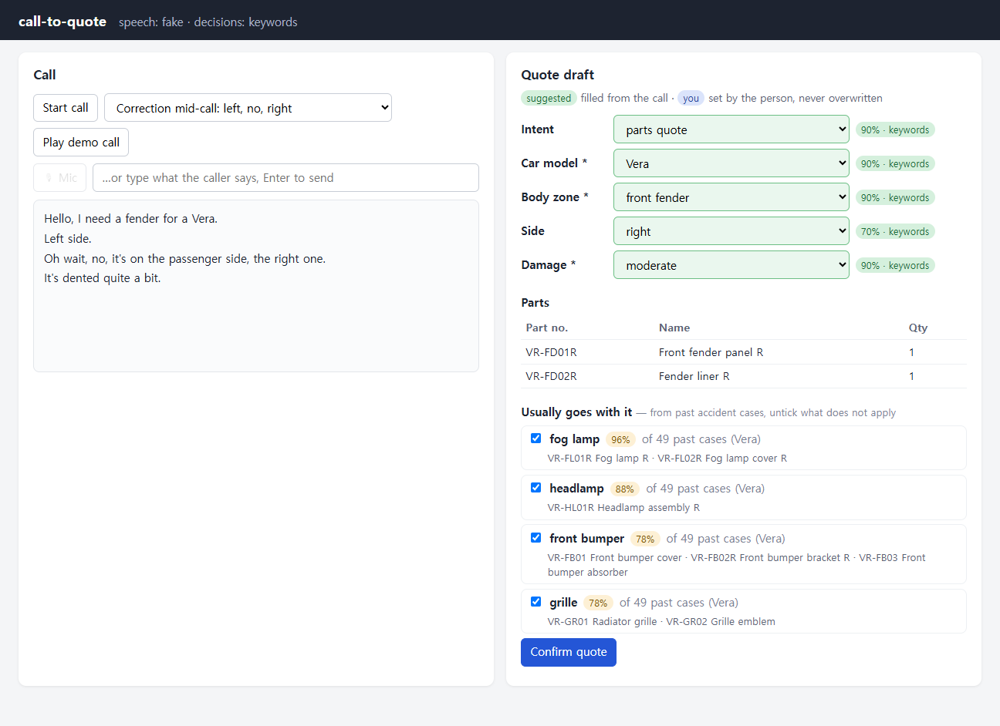
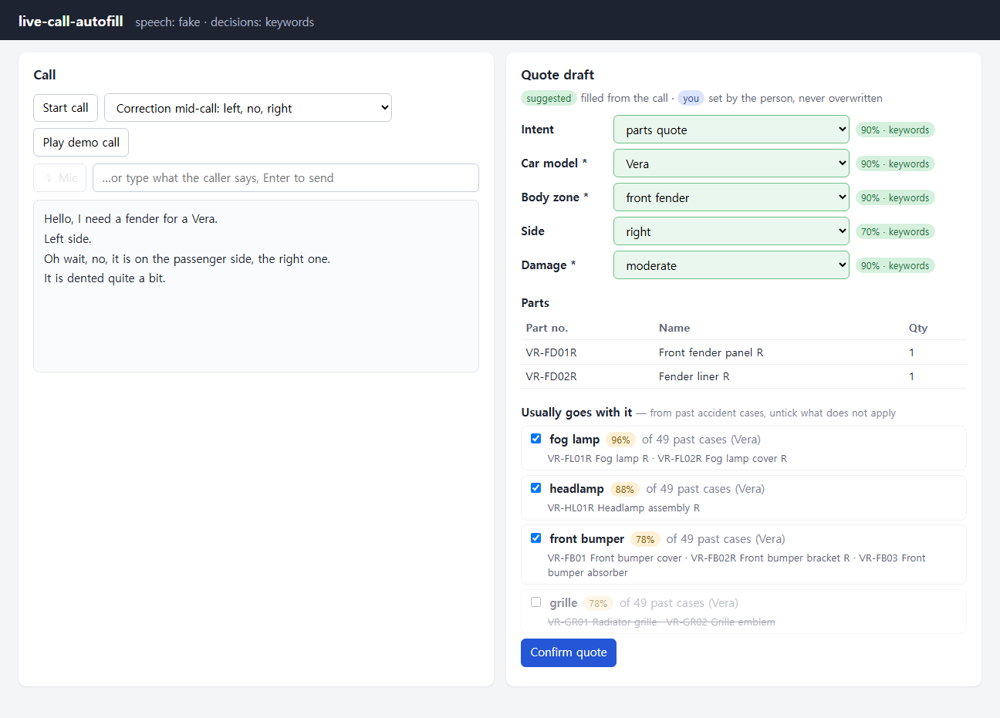

# mid-call-autofill

**While a customer is still on the phone, the quote form fills itself in — and the person on the call has the last word.**

A live phone call is turned into text (speech-to-text), a fast *decision model* picks the car, body zone, side and damage level from fixed lists, and the parts quote is pre-filled as **suggestions**. Nothing is sent until the person confirms. Anything the person types is never overwritten by the machine.

**Mid-call, not after the call.** There is no recording to process after hang-up: the draft is re-decided after every sentence and every few seconds of partial speech, so the person can check the suggestions and ask what is still missing before the caller hangs up.



> Status: the pipeline, the human-in-the-loop form and the keyless demo work and are tested. The real speech-to-text (ElevenLabs Scribe v2 Realtime) and decision-model (Jev) adapters are built and measured on English test calls (written scripts and synthetic speech): [eval/RESULTS.md](eval/RESULTS.md). Not done: narrowband phone audio, other languages, a real catalog; see [Roadmap](#roadmap).

**What was measured** (22 labelled calls, 102 checks, mostly written by me; 4 synthetic recordings, English only):
- Jev filled 74–75 of the 78 field values the caller gave before hang-up, **0 wrong**; all 24 fields that should stay empty stayed empty. Too few calls, mostly written by me, to put a tight number on the error rate: the 102 checks sit inside 22 calls, and the three runs repeat the same model.
- A general LLM (Claude Sonnet 5.5) also had 0 wrong in the same test (77 right); Jev was about 3.5× faster (0.43 s vs 1.5 s per decision), which is what makes re-deciding every few seconds practical. Whether Sonnet's missing probability causes wrong fills in practice was not measured.
- Deciding on partial speech brought the moment the draft held every expected field forward by 4–23 s on the 4 recordings, with the same final draft and no wrong value shown.

## Why

This grew out of automating an auto-parts dealership in Korea. The owner estimates that about 95% of orders arrive by phone: a repair shop calls, says something like *"a fender for the Vera — no, not left, the right one"*, and the dealer types it into a parts catalog and then into the dealer's ERP while still talking.

The dealership already runs a version-1 system I built: a browser quote tool, a desktop bot that types the confirmed quote into the dealer ERP, and watchers on the office PC. It is not in this repository because it contains customer data.
Its design, on invented fake systems, is in [legacy-erp-automation](https://github.com/Sungho-Park-DE/legacy-erp-automation).

This repository is the next step, rebuilt from scratch with invented data: **take the typing out of the call itself.**

## How it works

```mermaid
flowchart LR
  mic[Phone / mic audio] -->|PCM 16 kHz| stt[SpeechToText adapter<br/>ElevenLabs · fake]
  typed[Typed line / demo call] --> call
  stt -->|partial + final segments| call[Call<br/>transcript]
  call -->|each final segment, partials every few seconds| dec[Decider adapter<br/>Jev · fake]
  cat[Catalog<br/>options + parts] -->|choices| dec
  dec -->|answer + confidence| sync{confidence ≥ threshold?}
  sync -->|yes| draft[Draft<br/>suggested value]
  sync -->|no| retract[Draft<br/>retract suggestion]
  person[Person on the call] -->|edits win, always| draft
  person -->|Confirm| quote[Quote<br/>lines from Catalog]
```

**Why a decision model, not a chat LLM.** The form only ever needs answers from fixed lists (which car, which zone, which side, how bad). A decision model such as [Jev](https://typesafe.ai/blog/introducing-system-one-models-and-jev) returns one probability per allowed option instead of generating text: it cannot invent a part, it is fast enough to re-decide after every sentence, and its confidence becomes a simple threshold — below it the field stays empty and the person decides. Exact part numbers never come from the model; they come from the catalog.

**Design rules that come from the real shop:**
- *The person has the last word.* Machine values are shown as suggestions with their confidence; a value the person set is never overwritten; nothing is created without **Confirm**.
- *Empty beats wrong.* A low-confidence answer retracts an earlier suggestion instead of leaving a stale guess.
- *Last mention wins.* Callers correct themselves ("left — no, right"); every final sentence, and every few seconds of partial speech, triggers a fresh decision over the whole transcript, and answers to older transcripts are dropped.
- *Say what is missing.* Fields that are still empty are listed as questions to ask before hanging up ("Side: not heard yet → Which side?"), and a failing service shows a notice instead of ending the call.
- *When unsure, include.* If the side is unknown, both sides go on the quote — removing a line is easier than adding one.

## How data shaped the logic

The dealer's quote tool did not start from rules someone wrote down; it started from five years of sales. A repair shop that fixes a crashed car buys parts on several invoices over a few weeks, and nobody records *where* the car was hit or *how badly*. The analysis had to recover that from what was sold, and the app then uses the result while the person is quoting:

1. **One accident = the whole repair.** Invoices tied to one insurance claim are grouped, and a second claim for the same car within 30 days is merged into the first (in production about half the accidents had more than one invoice).
2. **Position, side and damage level come from the parts sold**, not from a form: position from which zones' core parts were replaced (front / rear / side only), side from left/right part markings, and damage level as the tertile of the number of parts within its position. Fasteners and consumables are dropped first.
3. **Companion zones:** for each car model × position × side × damage level, the share of accidents in which each zone was also replaced. A zone with a share of **30% or more** is put on the quote; a model with fewer than 20 accidents in that cell uses the all-models numbers.
4. **Why 30% and not 50%:** the owner's rule is *"when unsure, include it — removing a line is easier than adding one."* At 50%, the pre-filled parts were mostly right but caught only a third to a half of what was actually sold (table below), and every missing part is a second phone call.

This repository re-tells that chain with **invented** data, end to end:

```text
python -m datagen     # 5 years of invented accident claims → build/claims.csv
python -m analysis    # cases, shares, tertiles, 30% vs 50% backtest → app/data/zones.json + docs/data-report.md
```

The generator encodes only mechanisms (an impact has a position, a side and a depth; damage spreads to neighbouring zones as depth grows; deeper damage replaces more parts) plus the traps real data has: a second claim for the same car a few days later, and consumable lines that belong to no zone. It never contains target shares. The analysis does not know the mechanisms; it only sees invoice lines. In the app, the **Accident** concept reads `zones.json`: once the draft has a zone and a damage level, the companion zones appear under the parts as ticked lines with their share and sample size, and the person unticks what does not apply.



On the invented data (train 2021–2024, test 2025, 448 test cases) the same trade-off shows up as in the shop: companions at **0.30** give precision / recall **0.64 / 0.89**, at 0.50 they give 0.75 / 0.73; pre-filling every zone of the position gives 0.43 / 0.76. Merging supplements and dropping consumables, and where each matters, are in the [data report](docs/data-report.md).

The weakest point is circularity: the invented data was designed by the same person who wrote the analysis, so the analysis can only find structure that was planted as mechanism. That is why the invented-data numbers are in [docs/data-report.md](docs/data-report.md) and the numbers measured on the real shop are listed separately below.

### Measured in production

Measured on the dealer's own sales data and running tool (not in this repository). Sample sizes are given because some of them are small.

| What was measured | Result | Sample |
|---|---|---|
| Grouping invoices into accidents (claim + same car within 30 days) | about 3% of claim groups were merged into an earlier accident | 5 years of sales |
| Accidents with more than one invoice | 49%; 20% of part lines came on a later invoice | same 5 years |
| Same grouping with a 7-, 14- or 60-day window instead of 30 | number of accidents within ±1% of the 30-day value; the 49% and 20% stay at about 49% and 20%. At 60 days, accidents spanning more than 45 days double, so the window stays at 30 days | same 5 years |
| Side-only accidents (doors, mirror, sill — no front or rear core part) | 13% of accidents, more than front + rear together (5%) | same 5 years |
| Pre-filled parts at the old **50%** threshold: correct / share of sold parts caught | 70–85% correct, but only 30–55% caught | 5 years, one high-volume model |
| Backtest of the quote tool: part number exactly as sold, parts-catalog lookup vs sales history only | **230/237 (97%)** vs 193/237 (81%) | 19 recent accidents, 237 sold lines |
| Same backtest: pre-ticked parts, precision / recall, no damage level | 0.68 / 0.52 | same 19 accidents |
| Same, with the damage level per zone chosen correctly | **0.67 / 0.67** | same 19 accidents |
| Leakage lesson: taking the car model from the part master instead of the customer's car | a per-model menu (top 40 parts + sets) seemed to cover 71.9% of order lines; with the real car it covers 57.3% | 657 invoices with a recorded car, 4-year train / 1-year test split |

Caveats: in the backtest the zone, side and damage level were derived from what was actually sold, so it measures the tool *given the right buttons*, not the person's judgement. The damage level in the analysis is a tertile of part counts and is not guaranteed to match how the owner would call it. The leakage row comes from a separate analysis of maintenance orders; it is listed because it is the mistake that taught me to split by time and use only what is known at the time of the call.

## Architecture

The code is split into small, independent concepts, each a replaceable module:

| Concept | Purpose | Code |
|---|---|---|
| [Call](docs/concepts/Call.md) | the transcript of a live call, partials replaced by finals | `app/modules/call_v1` |
| [Draft](docs/concepts/Draft.md) | a form a machine may pre-fill; the person always wins | `app/modules/draft_v1` |
| [Catalog](docs/concepts/Catalog.md) | choices and the parts for car × zone × side × damage | `app/modules/catalog_v1` |
| [Quote](docs/concepts/Quote.md) | confirmed quotes | `app/modules/quote_v1` |
| [Accident](docs/concepts/Accident.md) | zones that usually go with a reported damage, from past cases | `app/modules/accident_v1` |

- Concepts never import each other; they meet only in [syncs](docs/concepts/syncs.md) (`app/syncs/flow.py`).
- Outside services sit behind two ports in `app/adapters/` (`SpeechToText`, `Decider`), each with a fake. Real and fake are chosen in one place by settings — the whole app and every test run without keys or network.
- Things known to change are listed in [volatile.md](docs/concepts/volatile.md): vendors, thresholds, the field list, the parts data.
- A material change can ship as a new module version (`draft_v2`) behind a feature flag (`CTQ_FLAG_<NAME>=1`, see `app/flags.py`), so it can be switched off without touching anything else.

## Run it

```bash
python -m venv .venv
.venv/bin/pip install -e ".[test]"        # Windows: .venv\Scripts\pip
cp .env.example .env                       # fake engines by default, no keys needed
.venv/bin/python -m uvicorn app.main:app --port 8800
```

Open http://127.0.0.1:8800, press **Start call**, then **Play demo call** — or type what a caller would say. Three scripted calls are included: a simple one, a mid-call correction, and one where the damage is unknown so the person has to pick it.

Tests (about a second, no network): `.venv/bin/python -m pytest -q`

With real engines: set `CTQ_STT=elevenlabs`, `CTQ_DECIDER=jev` and the keys in `.env`; the **Mic** button then streams your microphone. `CTQ_PARTIAL_DECIDE_SECS` (default 2.5, 0 = final segments only) sets how often the draft is re-decided while the caller is still talking. Measurements: [eval/RESULTS.md](eval/RESULTS.md).

## Roadmap

- [x] ElevenLabs Scribe v2 Realtime adapter and Jev adapter, measured on English test calls ([eval/RESULTS.md](eval/RESULTS.md))
- [x] Keyword boosting with the catalog's own words (`ELEVENLABS_KEYTERMS`), decisions on partial speech, notices instead of a dropped call when a service fails
- [ ] Narrowband (8 kHz) phone audio, other accents and languages: not measured
- [ ] Number of Jev calls per minute with partial decisions (cost), and less flicker on fields near the threshold
- [ ] Phone audio into the PC (handset tap or line adapter) instead of a microphone
- [ ] Several zones per call (one draft per zone)

## Data and privacy

All car names, part numbers and calls in this repository are invented. No real customer audio or transcripts are stored here. In production, sending call audio to outside services is a data-protection decision that has to be made with the business owner, and customers have to be told.

---

I built this locally and published it in 10/2026, so the history here starts on the day it went public.
